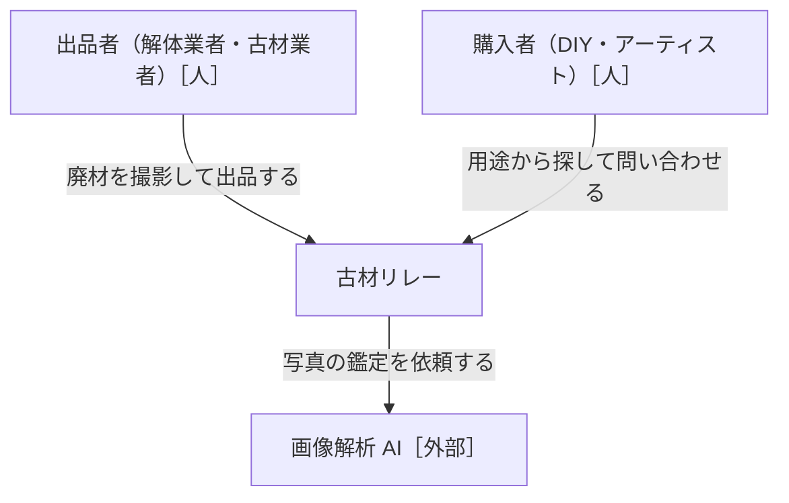
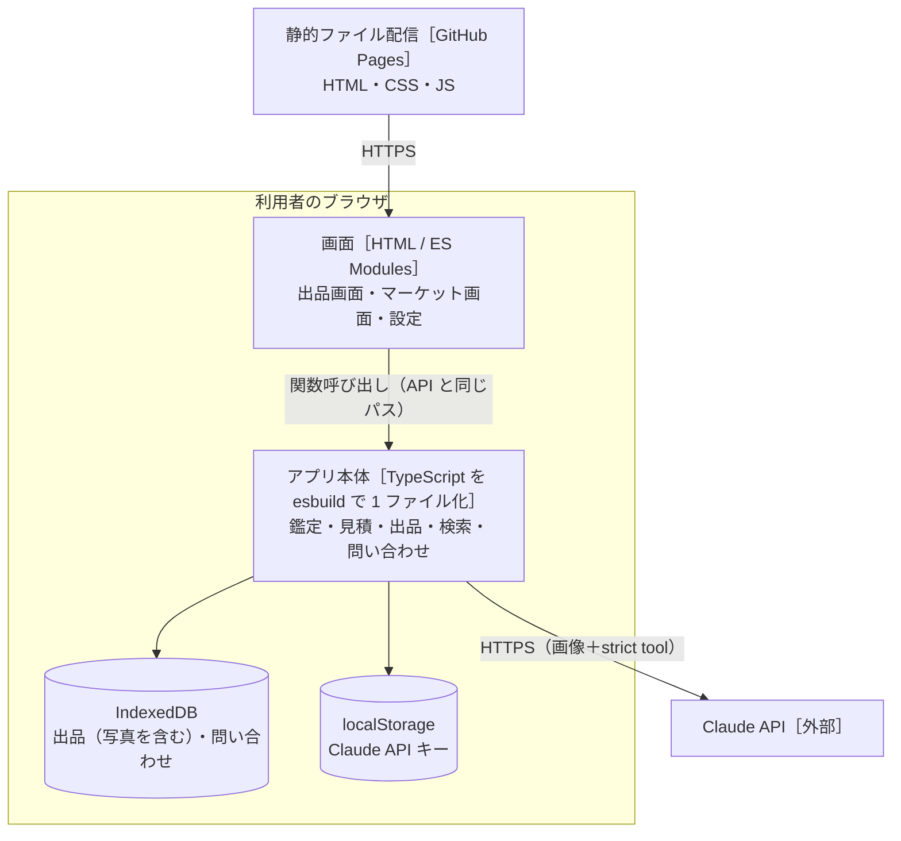
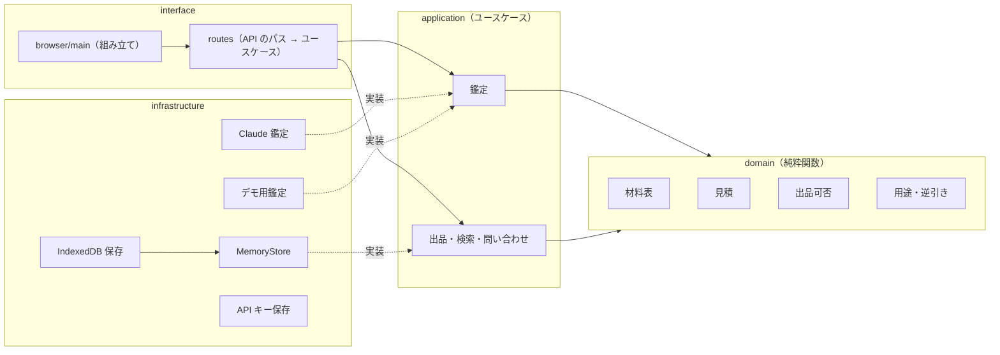

# 設計書：古材リレー（Kozai Relay）

- PRD：[prd.md](prd.md)
- 作成者：ohru131
- 更新日：2026-11-15
- 状態：草案（ハッカソン用デモ）

## 1. 背景と目的

古民家の解体で出る廃材を、写真 1 枚から出品データに変換し、DIY 利用者・アーティストが用途から探して問い合わせできるようにする。
AI は写真から「見て分かること」（種類・材質候補・寸法・状態・文章）だけを推定し、重量・価格・CO2・出品可否は決まった表と計算式で求める。
石綿含有のおそれがある建材は計算上の判定で出品を止める。
GitHub Pages で公開し、ブラウザ内で完結させる（[ADR 0002](adr/0002-static-hosting-browser-only.md)）。

## 2. やらないこと

- 決済・配送・ログイン・本人確認
- 写真からの石綿の有無の判定（判定するのは「おそれのある建材か」だけ）
- 端末をまたいだデータの共有（サーバーを置かない）
- フロントエンドフレームワークの導入

## 3. 全体図

### L1 システムコンテキスト

### L2 コンテナ

### L3 コンポーネントと層

層の依存（`code-rules.json` の `layers` と同じ）：

| 層 | import してよい | import してはいけない |
|---|---|---|
| `src/domain` | なし（標準の型のみ） | application・infrastructure・interface・外部 SDK |
| `src/application` | domain | infrastructure・interface・外部 SDK |
| `src/infrastructure` | domain・application（ポートの型） | interface |
| `src/interface` | すべて（組み立てる場所） | — |

application は「鑑定器」「保存先」をポート（TypeScript の interface 型）として持ち、実装は infrastructure にある。組み立ては `src/interface/browser/main.ts`（画面用）と `scripts/eval-photos.ts`（評価用）で行う。

## 4. コンポーネントと責務

### 材料表と見積（domain/materials, domain/estimate）
- 責務：材質ごとの密度・単価・石綿のおそれ・重量の誤差幅を持つ。寸法と材質から体積・重量範囲・参考価格・CO2 固定量・運搬目安を計算する
- 持つデータ（持ち主）：材料表（コード内の定数）
- 提供する入口：`MATERIALS`、`findMaterial(key)`、`estimate(...)`
- 依存するもの：なし
- 配置：`src/domain/`
- 計算式：
  - 体積 m³ = 長さ × 幅 × 厚さ（mm を m に換算）
  - 重量 kg = 体積 × かさ密度。範囲は ±誤差率（木材 15%、金属 5%、不明 30%）。実測値があれば実測値
  - 参考価格 = 単価（体積・1点・重量のいずれかの単位）× 状態係数（良 1.0／並 0.7／難あり 0.4）、100 円単位で丸め、下限 300 円
  - CO2 固定量 kg = 重量 × 0.85（気乾材の乾燥重量の比）× 0.5（炭素含有率）× 44/12。木材のみ
  - 運搬目安：20 kg 以下「1人で運べる」、60 kg 以下「2人で運ぶ」、それ以上「軽トラック・複数人」。長さ 2,000 mm 超は「長尺のため軽トラック」
- 完了の条件：
  - [ ] `test/domain.test.ts` が通る

### 出品可否（domain/hazard）
- 責務：材料と解体現場の築年・石綿調査の結果から、出品可否と注意事項を返す
- 判定：
  - 材料が石綿のおそれあり かつ 築年が 2006 年（9月の全面禁止）以前 → 調査結果が「不検出」なら可、「検出」なら不可、未調査なら不可（`blocked`、要分析調査）
  - 材料に塗装・防腐処理の注意がある → 可（`caution`、加工時の粉じん・焼却禁止を表示）
  - それ以外 → 可（`ok`）
- 配置：`src/domain/hazard.ts`

### 用途と逆引き（domain/recipes）
- 責務：寸法と種類から用途案を返す。「作りたいもの」（レシピ）の必要寸法と照合する
- レシピ：カウンター（長さ 1,800 以上・幅 250 以上・厚さ 30 以上の木材）、ベンチ、棚板、テーブル天板、額縁・小物、照明、間仕切り・壁面装飾
- 配置：`src/domain/recipes.ts`

### 鑑定（application/appraise）
- 責務：写真と基準物・メモを鑑定器ポートに渡し、AI の推定に見積・用途案・出品可否を加えた「鑑定結果」を返す
- ポート：`Appraiser.appraise({ imageBase64, mediaType, reference, memo, site }) → { ai, source }`
- 配置：`src/application/appraise.ts`

### 出品・検索・問い合わせ（application/listings）
- 責務：出品の作成（出品可否の判定を含む）・一覧・取得・検索・逆引き、問い合わせの作成
- ポート：`Store`（同期の読み書き。永続化は実装側で行う）
- 冪等性：作成は `requestId` を受け取り、同じ値なら最初の結果を返す
- 配置：`src/application/listings.ts`

### Claude 鑑定（infrastructure/claude-appraiser）
- 責務：Claude API（`claude-opus-5-5`、effort `low`）に画像とメモを送り、strict tool `register_material` の入力として構造化結果を受け取る
- クライアントは呼び出しのたびに取得する（設定画面でキーを変えたらすぐ反映する）
- 拒否（`stop_reason: refusal`）・ツール未呼び出しは `APPRAISAL_FAILED`、認証エラーは `UNAVAILABLE`（キーの確認を促す）に変換する
- サーバー側フォールバック（`fallbacks: "default"`）を有効にする
- 配置：`src/infrastructure/claude-appraiser.ts`

### デモ用鑑定（infrastructure/mock-appraiser）
- 責務：API キーが未設定のとき、メモのキーワード（障子・瓦・スレートなど）または既定値から決まった推定を返す
- 配置：`src/infrastructure/mock-appraiser.ts`

### 保存（infrastructure/memory-store, infrastructure/browser/idb）
- `MemoryStore`：`Store` の実装。メモリ上に持ち、変更のたびに `persist` コールバックを呼ぶ。テストと評価スクリプトはコールバックなしで使う
- `idb`：IndexedDB（`kozai-relay` データベース）から起動時に読み込み、`persist` で書き戻す。初回はサンプルの出品を入れる。設定画面から初期化できる
- 写真は `data:` URL として出品に含める
- 配置：`src/infrastructure/memory-store.ts`、`src/infrastructure/browser/idb.ts`、`src/infrastructure/seed.ts`

### API キー保存（infrastructure/browser/api-key）
- 責務：localStorage の `kozai-relay.anthropicApiKey` にキーを保存・取得・削除する。キーの確認（`models.retrieve`）を行う
- 配置：`src/infrastructure/browser/api-key.ts`

### ルーティング（interface/routes）
- 責務：API のパスとメソッドをユースケースに対応づけ、`AppError` を API 契約のエラー本文と HTTP 相当のステータスに変換する
- 配置：`src/interface/routes.ts`

### 画面（public/）
- 出品画面 `index.html`：現場の選択 → 撮影 → 鑑定 → 確認・修正（見積を再計算）→ 出品
- マーケット画面 `market.html`：作りたいもの・種類・長さ・キーワードで検索、詳細、問い合わせ
- 設定（両画面のヘッダーから開く）：API キーの保存・確認・削除、デモデータの初期化
- 計算は画面に書かない。再計算は `POST /api/estimates` を呼ぶ
- 画像は送信前に長辺 1,568 px の JPEG に縮小する
- パスはすべて相対パスにする（Pages は `/haizai/` 配下で配信される）

## 5. API契約

詳細は [api/openapi.yaml](api/openapi.yaml)。ネットワークは介さず、`src/interface/routes.ts` がブラウザ内で同じパスを処理する。

| コンポーネント | メソッド | パス | 概要 |
|---|---|---|---|
| 鑑定 | POST | `/api/appraisals` | 写真を鑑定し、推定値と見積を返す（保存しない） |
| 見積 | POST | `/api/estimates` | 寸法・材質・現場から見積と出品可否を返す |
| 解体現場 | GET | `/api/sites` | 解体現場の一覧 |
| 出品 | POST | `/api/listings` | 出品する |
| 出品 | GET | `/api/listings` | 検索（`q`・`category`・`minLength`・`recipe`） |
| 出品 | GET | `/api/listings/{listing_id}` | 出品の詳細 |
| 問い合わせ | POST | `/api/listings/{listing_id}/inquiries` | 購入希望・問い合わせを送る |
| 補助 | GET | `/api/catalog` | 材料表・レシピ・基準物の一覧と鑑定器のモード |

### エラー方針

レスポンスは `{ "error": { "code", "message" } }`。

| コード | ステータス | 意味 | 呼び出し側の対応 |
|---|---|---|---|
| INVALID_ARGUMENT | 400 | 入力が不正（寸法が 0 以下、未知の材質など） | 入力を直す |
| NOT_FOUND | 404 | 出品・現場がない | 再試行しない |
| FAILED_PRECONDITION | 409 | 石綿のおそれがあり出品できない | 分析調査の結果を入力する |
| APPRAISAL_FAILED | 422 | AI が鑑定できなかった（写真が不鮮明・拒否） | 撮り直す、または手入力する |
| UNAVAILABLE | 503 | AI が使えない（キーの誤り・通信エラー） | キーを確認する、待って再試行、または手入力する |

### 冪等性・タイムアウト

- `POST /api/listings`・`POST /api/listings/{id}/inquiries` は `requestId` を受け取り、同じ値なら最初の結果を返す
- 鑑定のタイムアウトは 60 秒（SDK の設定）。失敗したら手入力に切り替える

## 6. デプロイ構成

| コンテナ | 実行環境 | 台数・複製 | 理由 |
|---|---|---|---|
| 静的ファイル | GitHub Pages（`main` への push で GitHub Actions がテスト・ビルド・配置） | — | 運用費がかからない。スマホから URL で開ける |
| アプリ本体・保存 | 利用者のブラウザ | 端末ごと | サーバーを置かない |

- 秘密情報の置き場所：Claude API キーは利用者のブラウザの localStorage。リポジトリ・ビルド成果物には含めない。評価スクリプト用のキーは `.env`（git の対象外）
- バックアップ・停止の許容：デモ用。ブラウザのデータを消すとサンプルから作り直す
- 費用の目安：鑑定 1 回あたり数円（利用者のキーに課金）

## 7. 代替案とトレードオフ

| 論点 | 採用 | 不採用の案 | 理由 |
|---|---|---|---|
| 重量・価格の求め方 | AI は寸法と材質だけ推定し、重量・価格は材料表で計算 | AI に重量・価格も推定させる | 同じ入力で同じ結果になる。根拠を説明できる。修正時に再計算できる（ADR 0001） |
| 寸法の推定 | 写真内の基準物（A4・名刺）から AI が推定し、人が確認 | AR・LiDAR 計測 | ブラウザだけで動く。機種に依存しない |
| 石綿の扱い | 材料の種類と築年で出品を止める | 写真から石綿を判定する | 写真では判定できない。法令上は分析調査が必要 |
| AI 出力の形 | strict tool use（`tool_choice: auto` ＋指示） | 自由文を解析 | スキーマどおりの値を受け取れる。Opus 5.5 は強制ツール指定を受け付けない |
| 公開方法 | GitHub Pages ＋ブラウザ内で完結 | Node.js サーバーを常時稼働 | 運用費がかからない。利用者のキーを使える。代わりに端末間でデータを共有できない（ADR 0002） |
| API キーの置き場所 | 利用者のブラウザの localStorage | 運営側サーバーで保持 | 静的ホスティングで秘密情報を持てない |
| キー未設定時 | デモ用鑑定に切り替える | 鑑定不可 | キーがなくても操作の流れを見せられる |

## 8. 未決事項

| 項目 | いつ・何をもとに決めるか |
|---|---|
| 参考価格の単価表 | 奈良の古材業者への聞き取り後 |
| 寸法推定の精度 | 実物の写真 5 点で `npm run eval` を実行し、基準物の種類を決める |
| 端末間のデータ共有 | 展示後、利用を続ける場合にサーバーまたは BaaS の導入を判断する |
